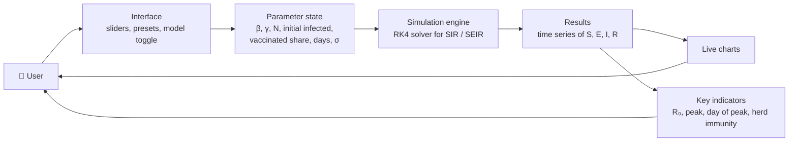
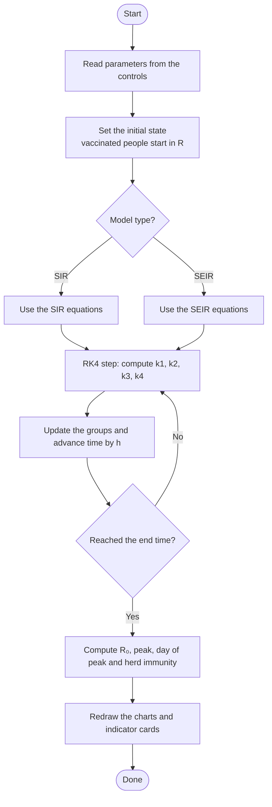
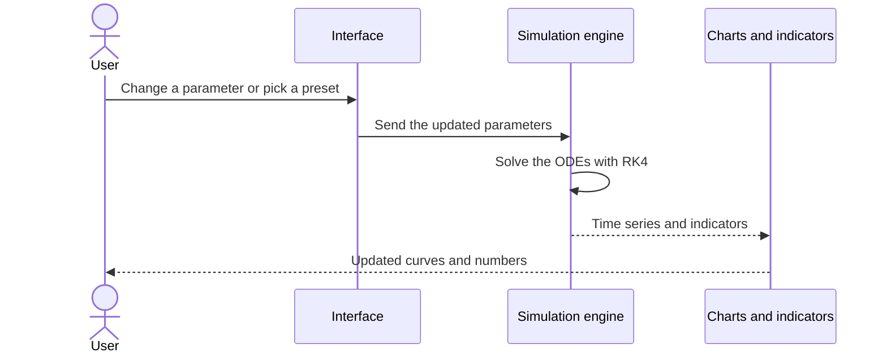

# 🦠 SIR Epidemic Model

### An interactive simulator for modelling the spread of an epidemic with differential equations

**[🌐 Open the live website](https://sir-epidemic-model.vercel.app/)** *(laptop or PC recommended for the best experience)*

---

## 📑 Table of Contents

- [About the Project](#-about-the-project)
- [Features](#-features)
- [The Mathematical Model](#-the-mathematical-model)
- [Analytical Results](#-analytical-results)
- [Numerical Method](#-numerical-method)
- [Project Architecture](#-project-architecture)
- [Deployment](#-deployment)
- [Real-World Applications](#-real-world-applications)
- [Limitations and Future Work](#-limitations-and-future-work)
- [References](#-references)

---

## 📖 About the Project

When an infectious disease such as influenza, measles or COVID-19 enters a community, authorities must decide **before** it spreads: how fast will it grow, when will it peak, and how many people will be sick at the same time? A tall, sudden peak can overwhelm hospitals, and real populations cannot be used for experiments.

This project answers those questions with the classical **SIR model** (Kermack and McKendrick, 1927). It:

1. **Models** the population as Susceptible, Infected and Recovered groups using three nonlinear ODEs.
2. **Solves** the equations numerically with the fourth-order Runge-Kutta method.
3. **Analyses** the results, finds the peak, and tests what-if scenarios such as distancing, vaccination and incubation.

The result is an interactive website where anyone can change the parameters and watch the epidemic curve respond instantly.

This is an **Engineering Mathematics** project that combines differential equations, integration and numerical methods.

---

## ✨ Features

- **Interactive simulator** with adjustable infection rate (β), recovery rate (γ), population, initially infected people, vaccinated share and simulation length
- **SIR and SEIR models** (the SEIR extension adds an incubation period)
- **Live charts** of the Susceptible, Infected and Recovered curves
- **Key indicators**: R₀, peak infections, day of the peak and the herd-immunity threshold
- **Preset scenarios**: baseline, distancing, vaccination and incubation
- **Step-by-step maths**: variables, equations, derivations and the numerical method explained on the site

---

## 🧮 The Mathematical Model

The population of size $N$ is divided into three groups, and everyone moves in one direction only: **S → I → R**.

$$\frac{dS}{dt} = -\beta \frac{S I}{N}$$

$$\frac{dI}{dt} = \beta \frac{S I}{N} - \gamma I$$

$$\frac{dR}{dt} = \gamma I$$

### Variables and parameters

| Symbol | Name | Role in the model | Value used |
|:--:|---|---|---|
| $S(t)$ | Susceptible | People who can still catch the disease; decreases as infection spreads | 999,999 at $t=0$ |
| $I(t)$ | Infected | People spreading the disease now; drives new cases | 1 at $t=0$ |
| $R(t)$ | Recovered | Recovered or immune people; they no longer spread it | 0 at $t=0$ |
| $N$ | Total population | Fixed size, $S + I + R = N$ | 1,000,000 |
| $\beta$ | Infection rate | How quickly contacts turn into infections | 0.4 per day |
| $\gamma$ | Recovery rate | Speed of recovery; $1/\gamma$ is the average number of infectious days | 0.1 per day |
| $R_0 = \beta/\gamma$ | Basic reproduction number | New cases caused by one case; above 1 the outbreak grows | 4 |
| $t$ | Time | Independent variable, in days | 0 to 160 |

### Assumptions

- Closed population (no births, deaths or travel)
- Everyone mixes equally
- Recovery gives lasting immunity
- $\beta$ and $\gamma$ stay constant over time

### SEIR extension

Adding an Exposed group $E$ with incubation rate $\sigma$ (here $\sigma = 0.2$ per day, a 5-day incubation period):

$$\frac{dS}{dt} = -\beta \frac{SI}{N}, \quad \frac{dE}{dt} = \beta \frac{SI}{N} - \sigma E, \quad \frac{dI}{dt} = \sigma E - \gamma I, \quad \frac{dR}{dt} = \gamma I$$

---

## 📐 Analytical Results

1. **Conservation:** adding the equations gives $\frac{d(S+I+R)}{dt} = 0$, so $S + I + R = N$ at all times (used as an accuracy check).
2. **Outbreak condition:** the infection grows when $R_0 \cdot S/N > 1$.
3. **Peak condition:** the peak occurs when $S = N/R_0$.
4. **I versus S:** $\frac{dI}{dS} = -1 + \frac{N}{R_0 S}$, which integrates to $I = N - S + \frac{N}{R_0}\ln\frac{S}{N}$.
5. **Peak size:**

$$I_{max} = N\left[1 - \frac{1 + \ln R_0}{R_0}\right]$$

6. **Herd immunity:** the outbreak cannot grow once a fraction $1 - 1/R_0$ of the population is immune.

There is no closed-form solution for $I(t)$, because the system is nonlinear, so a numerical method is needed.

---

## 🔢 Numerical Method

The system is solved with the **fourth-order Runge-Kutta (RK4)** method:

$$k_1 = f(t_n, y_n), \quad k_2 = f\left(t_n + \tfrac{h}{2},\, y_n + \tfrac{h k_1}{2}\right)$$

$$k_3 = f\left(t_n + \tfrac{h}{2},\, y_n + \tfrac{h k_2}{2}\right), \quad k_4 = f(t_n + h,\, y_n + h k_3)$$

$$y_{n+1} = y_n + \frac{h}{6}\left(k_1 + 2k_2 + 2k_3 + k_4\right)$$

RK4's error shrinks like $h^4$, compared with $h$ for Euler's method. With a small step, $S + I + R$ stays equal to $N$, which is used to check the solution.

---

## 🏗️ Project Architecture

### Project workflow

How the project goes from a real-life problem to a working website.

### System architecture

The website is a client-side application: all calculations run in the browser, so no backend or database is needed.

| Layer | Responsibility |
|---|---|
| **Interface** | Collects parameters from sliders, inputs and preset buttons |
| **Parameter state** | Holds the current values of β, γ, N, initial infected, vaccinated share, duration and σ |
| **Simulation engine** | Solves the SIR or SEIR equations with the RK4 method |
| **Visualisation** | Draws the S, E, I and R curves and shows the key indicators |
| **Hosting** | Static deployment on Vercel |

### Simulation flow

What happens every time a parameter changes.

### User interaction

### Disease progression models

---

## ☁️ Deployment

The website is deployed on [Vercel](https://vercel.com/) and is live at **https://sir-epidemic-model.vercel.app/**.

---

## 🌍 Real-World Applications

| Use | How the model helps |
|---|---|
| 🏥 **Hospital planning** | Predicts the peak so beds, ICUs and staff are ready in time |
| 📋 **Testing policies** | Compares masks, distancing and lockdowns by changing $\beta$ |
| 💉 **Vaccination targets** | Immunise at least $1 - 1/R_0$ of people to stop an outbreak |
| 🚨 **Early warning** | $R_0 > 1$ signals a growing outbreak |
| 📢 **Public communication** | Flatten-the-curve graphs explain why measures matter |
| 🔗 **Beyond health** | The same maths models rumours, computer viruses and product adoption |

---

## 🔭 Limitations and Future Work

**Limitations:** the basic model assumes a closed population, equal mixing, constant $\beta$ and $\gamma$ and lasting immunity. Real epidemics involve births, deaths, travel, changing behaviour and age structure.

**Future work:**

- [ ] Fit $\beta$ and $\gamma$ to real case data
- [ ] Add age groups and travel between regions
- [ ] Time-varying contact rates (for example, a lockdown starting on a given day)
- [ ] Continuous vaccination and waning immunity
- [ ] Stochastic simulation for small populations

---

## 📚 References

1. W. O. Kermack and A. G. McKendrick, "A contribution to the mathematical theory of epidemics," *Proceedings of the Royal Society A*, 115(772), 700-721, 1927.
2. H. W. Hethcote, "The mathematics of infectious diseases," *SIAM Review*, 42(4), 599-653, 2000.
3. F. Brauer and C. Castillo-Chavez, *Mathematical Models in Population Biology and Epidemiology*, Springer.

---

**If you found this project useful, please consider giving it a ⭐**

[🌐 Live Demo](https://sir-epidemic-model.vercel.app/)

